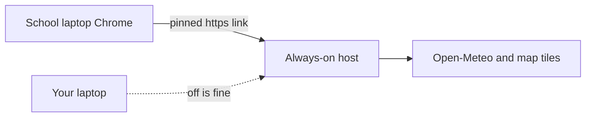

# Always-on HydroFlow link

Both laptops can be off. The school laptop is only a screen. Weather stays current because the running server calls Open-Meteo when someone opens the dashboard. Nothing in this project has a license key.

The app is already one Docker stack in [docker-compose.yml](docker-compose.yml): PostGIS, FastAPI, and the dashboard on port 8080. Nginx in [frontend/nginx.conf](frontend/nginx.conf) sends `/api/` to the backend, so one link is enough. The database defaults to SQLite in [backend/app/db.py](backend/app/db.py), but the Compose file uses PostgreSQL. Leave that stack as it is.

A GitHub clone is not a full copy. [.gitignore](.gitignore) leaves out `artifacts/` and `data/processed/`, and Compose mounts `data/processed/validated_daily.csv`. The host needs this whole working folder, not only the GitHub repo.

## The great way

Use a small cloud server that stays on when every laptop is shut down, then put the existing Compose stack on it and give the supervisor one `https://` bookmark.

Pick the host in this order:

- **Pay about $5 a month: this is the great way.** A 2 GB or 4 GB VPS (Hetzner, or a similar provider) in a nearby region. Docker is supported, the machine is not on a 12-month trial, and nobody has to keep a PC powered at school. Add a domain if you have one. If you do not, the server IP with HTTPS from Caddy still works as the pinned link.
- **Pay nothing, and accept more setup risk.** Oracle Cloud Always Free Ampere VM (the free shape with enough RAM for PostGIS). This is the only common free option meant to last for years. Google’s always-free `e2-micro` has 1 GB RAM and is too small for this stack. AWS and Azure free trials end after about a year, so they fail the “longer than a month” requirement.

Do not use either laptop, ngrok, or a Cloudflare Tunnel from a laptop. Those die when the machine shuts down. Do not use GitHub Pages, Netlify, or Vercel alone. They cannot run this API and database. Do not use Render or Railway free plans. They sleep or run out of credit.

## Ways that are possible, and why they lose

- **School laptop with Docker, started at login.** Works only while that laptop is on and signed in. You already ruled this out because it can shut down.
- **Mini PC or school desktop left plugged in at school.** Fine only if the school agrees that this other machine is never shut down and stays on the internet. The link is then that machine. A normal laptop does not qualify. School firewalls often block visitors from outside, so the link may work only on school Wi-Fi.
- **Free app platforms (Render, Railway, Fly.io free allowance).** Easy at first, then the site sleeps, the database expires, or the credit ends. Bad for a supervisor demo with no one there to wake it.
- **Split hosting (static site plus a separate database).** More accounts to keep alive, same sleep and expiry problems. The current Compose file is simpler.

## What to do on the chosen server

One setup session from your laptop. After that, your laptop can stay off.

1. Create the VPS or Oracle VM with Ubuntu, 2 GB RAM or more, and 20 GB disk or more. Allow ports 22, 80, and 443. Do not open 5432.
2. Install Docker and the Compose plugin.
3. Copy the full `HydroFlow_V2` folder to the server, including `artifacts/`, `ml/models/`, and `data/processed/validated_daily.csv`. A USB stick cannot reach a cloud VM. Use `scp` or `rsync` of this folder.
4. On the server, set a real database password in the Compose environment. The value `hydroflow_dev` in [docker-compose.yml](docker-compose.yml) is only for local development.
5. Add `restart: unless-stopped` to the `db`, `backend`, and `frontend` services so a reboot of the server brings the site back. The school laptop rebooting does nothing to the site.
6. Put Caddy or another reverse proxy on ports 80 and 443, forwarding to `127.0.0.1:8080`, so Chrome gets a normal `https://` link. Keep the app bound to localhost if the proxy is on the same machine.
7. Run `docker compose up --build -d` once. Open the public link and check the dashboard, map, and weather.
8. On the school laptop, bookmark that link and pin it. No Docker install there. Opening the bookmark loads the latest weather, because the forecast is requested when the page loads ([frontend/src/hooks/usePredictionTimeline.ts](frontend/src/hooks/usePredictionTimeline.ts) has no timer). For a tab left open during a long talk, use a Chrome auto-refresh extension at about 30 minutes, or press F5.

The school laptop still needs internet to reach the link. The server needs outbound internet for Open-Meteo and map tiles. Elevation lookup stays optional (`OPENTOPOGRAPHY_API_KEY` in [.env.example](.env.example)).

## What this does not do

This remains an academic prototype. A public link does not make the flood scores an official warning. If the cloud bill stops or the Oracle account is closed, the link stops. Check the site once after you deploy it, then the supervisor can open it without you.